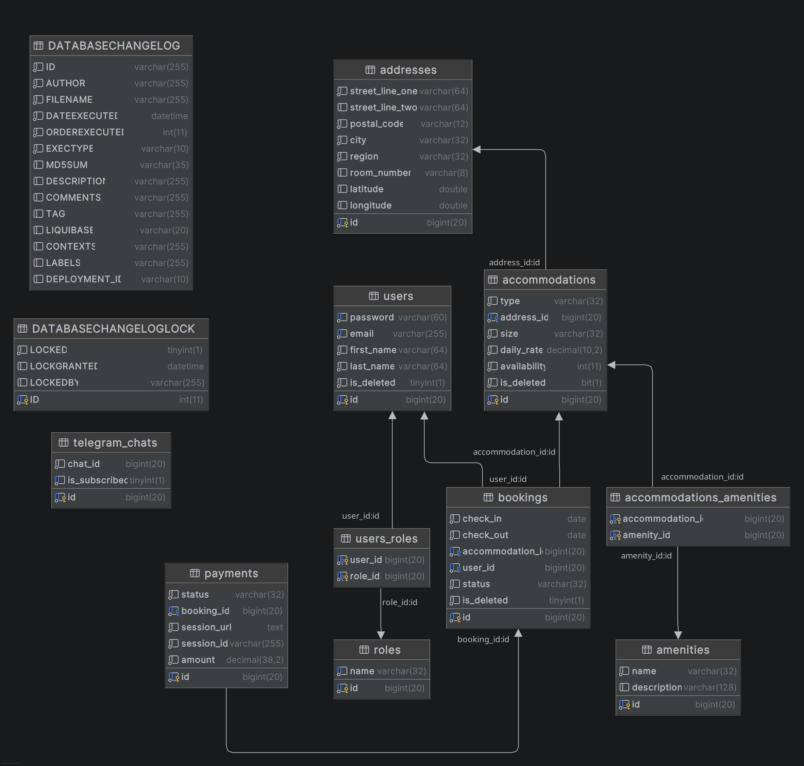

# Simple Accommodation Booking Service

A backend application for managing accommodation bookings, built with Java and Spring Boot. The project provides secure authentication and authorization, payment processing through Stripe, and automated Telegram notifications.

## Features

- **Accommodation Booking** — REST API for managing accommodations and bookings.
- **Stripe Payments** — integration with Stripe Checkout for processing booking payments.
- **Stripe Webhooks** — handling payment events to synchronize payment status with the application.
- **Role-Based Access Control** — Bearer token authentication with `USER` and `ADMIN` roles.
- **Telegram Notifications** — automated notifications about important booking and payment events.
- **Database Integration** — MariaDB integration with a Docker-based development environment.
- **Automated Testing** — a test suite covering approximately 71% of the codebase.

## Tech Stack

- **Language:** Java
- **Framework:** Spring Boot
- **Database:** MariaDB
- **Authentication:** Bearer Token Authentication, Role-Based Access Control
- **Payments:** Stripe API, Stripe Webhooks
- **Notifications:** Telegram Bot API
- **Containerization:** Docker, Dockerfile

## Model diagram



## Security

The application implements authentication and role-based authorization to control access to protected endpoints. The `USER` and `ADMIN` roles provide different levels of access to application functionality.

Sensitive configuration, including API keys and credentials, should be supplied through environment variables or external configuration rather than committed to version control.

## Payment Processing

Stripe integration enables users to initiate payments for bookings through Stripe Checkout. Stripe webhooks allow the application to receive payment event notifications and update the corresponding payment state.

## Testing

The project includes automated tests covering approximately **71% of the codebase**, helping verify application behavior and reduce regressions during development.

## Running the Application

The project includes a `Dockerfile` for containerizing the application and supporting integration with MariaDB.

Configure the required environment variables and application properties before starting the application. Stripe credentials, webhook configuration, Telegram bot credentials, and database connection settings must be provided separately.

Use Docker to build and run the application in a containerized environment.

## Project Goals

The primary goal of this project was to develop a backend booking service while applying practical software engineering concepts, including REST API development, secure authentication and authorization, external service integration, database management, containerization, and automated testing.

## User guide

### 1. Prerequisites

- [Docker](https://docs.docker.com/get-docker/) and Docker Compose
- (Optional, for running without Docker) JDK 17+ and Maven
- A [Stripe](https://stripe.com) account (test mode is enough)
- A Telegram bot token and chat ID (create a bot via [@BotFather](https://t.me/BotFather))

### 2. Configuration

1. Create a `.env` file in the project root and fill in all values. Use `.env.template` as an example.
2. If you run the service on a remote server, verify the base URL and change it in `application.properties`.
3. Make sure Docker is installed and running.

To test Stripe webhook integration locally, you can use the Stripe CLI to forward events to your application.

1. Install the [Stripe CLI](https://docs.stripe.com/stripe-cli) and authenticate it with your Stripe account.
2. Start the application and ensure that the webhook endpoint is available.
3. Run the following command, replacing the endpoint with the actual webhook URL configured in the application:

   ```bash
   stripe listen --events checkout.session.completed,checkout.session.expired --forward-to localhost:8080/webhook/stripe
   ```

4. Copy the webhook signing secret (`whsec_...`) provided by the CLI and configure it in the application.
5. Trigger a test event or complete a test payment to verify webhook processing.

### 3. Running the application

```bash
docker compose up --build
```

The API will be available at `http://localhost:8080` (or the port configured in `.env`).
To stop the application:

```bash
docker compose down
```

### 4. Authentication

The API uses JWT authentication.

1. Register a new user: `POST /auth/registration`
2. Log in: `POST /auth/login` – the response contains a JWT token.
3. Pass the token in the `Authorization` header of every protected request:

**Note:** The webhook URL and signing secret must match your application configuration. Use Stripe test mode for local development and never commit API keys or webhook secrets to version control.